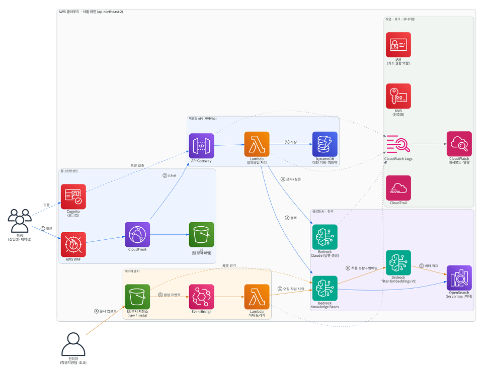

# 캠퍼스 길잡이 (campus-guide-chatbot)

대학 생활 안내 RAG 챗봇 · 클라우드 아키텍처 수업 과제

## 1. 프로젝트 소개

**캠퍼스 길잡이**는 학생이 학사·장학·졸업요건 등을 질문하면 학교 공식 문서에서 근거를 찾아 **출처와 함께** 답하는 RAG(Retrieval-Augmented Generation) 챗봇입니다.

| 항목 | 내용 |
| --- | --- |
| 대상 사용자 | 신입생·재학생 (문서 관리: 학생지원팀·조교) |
| 질문 분야 | 학사, 장학, 졸업요건 등 대학 생활 안내 |
| 답변 방식 | 학교 문서 검색 → 근거 기반 답변 생성 → 출처 표시 |
| 최종 구성 | API Gateway + Lambda + Bedrock Knowledge Bases + OpenSearch Serverless + S3 |
| 배포 형태 | 서버리스, AWS 서울 리전 (`ap-northeast-2`) |

## 2. 아키텍처 구성도



- **질의응답 흐름:** 학생 → WAF → CloudFront(S3 정적 웹) → API Gateway `/chat`(Cognito 토큰 검증) → Lambda → Bedrock Knowledge Bases 검색 → Bedrock Claude 답변 생성 → DynamoDB에 대화 기록·피드백 저장
- **문서 준비 흐름:** 관리자가 S3 문서 저장소(`raw/`, `meta/`)에 업로드 → EventBridge → 트리거 Lambda → Knowledge Base 수집 작업(추출·분할·Titan Embeddings V2 임베딩) → OpenSearch Serverless 벡터 적재
- **보안·로그·모니터링:** IAM 최소 권한 역할, KMS 암호화, CloudWatch Logs·대시보드·알람, CloudTrail

## 3. 폴더 구조

```
campus-guide-chatbot/
├── backend/
│   └── health/
│       └── lambda_function.py   # /health API용 Lambda 함수
├── infra/
│   └── campus-guide-docs-read.json  # Lambda 역할에 연결한 IAM 정책
├── docs/
│   └── architecture.png         # 아키텍처 구성도
├── frontend/                    # 웹 프론트엔드 (예정)
└── README.md
```

| 폴더 | 설명 |
| --- | --- |
| `backend/health` | 문서 버킷 접근 여부를 확인하는 헬스 체크 Lambda (`campus-guide-health`) 코드 |
| `infra` | AWS 리소스 설정 파일. 현재는 문서 버킷 읽기 전용 IAM 정책 JSON |
| `docs` | 아키텍처 구성도 등 프로젝트 문서 |
| `frontend` | S3 + CloudFront로 배포할 정적 웹 페이지 (아직 비어 있음) |

## 4. 2주차 구성 AWS 리소스

| 구분 | 리소스 | 설정 내용 |
| --- | --- | --- |
| IAM 사용자·그룹 | 개발용 IAM 사용자 | AdministratorAccess 그룹에 소속, 루트 계정·사용자 모두 MFA 적용 |
| CLI 인증 | `aws login` | 장기 액세스 키 대신 임시 자격 증명 사용 |
| S3 | `campus-guide-docs-esther` | 학교 문서 저장소, 퍼블릭 액세스 차단, 버전 관리 활성화 |
| S3 | `campus-guide-web-esther` | 웹 정적 파일용 버킷 |
| IAM 역할 | `campus-guide-lambda-role` | CloudWatch 로그 기록 + 문서 버킷 `ListBucket`/`GetObject`만 허용 (정책: [`infra/campus-guide-docs-read.json`](infra/campus-guide-docs-read.json)) |
| Lambda | `campus-guide-health` | Python, 문서 버킷 접근 확인용 |
| API Gateway | `campus-guide-api` | HTTP API, `GET /health`, 초당 5회·버스트 10회 호출 제한 |
| CloudWatch Logs | Lambda 로그 그룹 | 로그 보관 기간 30일 |

## 5. `/health` API

### 호출 방법

```bash
curl https://<api-id>.execute-api.ap-northeast-2.amazonaws.com/health
```

### 동작 방식

[`backend/health/lambda_function.py`](backend/health/lambda_function.py)는 다음 순서로 동작합니다.

1. 환경 변수 `DOCS_BUCKET`에서 문서 버킷 이름을 읽습니다.
2. `s3:ListBucket` 권한으로 버킷의 `raw/` 경로 객체 목록을 조회합니다.
3. 키가 `/`로 끝나는 폴더 객체는 제외하고 실제 파일만 셉니다.
4. 조회에 실패하면 예외를 잡아 `s3_access: false`로 표시하고, 오류 내용을 CloudWatch Logs에 `s3_error` 이벤트로 남깁니다.
5. 서비스 상태, S3 접근 여부, 문서 수, 문서 목록(최대 5개), 리전, 현재 시각(UTC)을 JSON으로 응답합니다.
6. 같은 내용을 `health_check` 이벤트로 CloudWatch Logs에 기록합니다.

> S3 접근에 실패해도 HTTP 상태 코드는 항상 `200`입니다. 실제 버킷 접근 여부는 응답의 `s3_access` 값으로 확인합니다.

### 응답 예시

정상 응답 (`200 OK`, `Content-Type: application/json; charset=utf-8`):

```json
{
  "service": "campus-guide",
  "status": "ok",
  "s3_access": true,
  "doc_count": 2,
  "docs": [
    "raw/학사안내.pdf",
    "raw/장학금_지급규정.pdf"
  ],
  "region": "ap-northeast-2",
  "time": "2026-11-24T05:30:12.345678+00:00"
}
```

S3 접근 실패 시:

```json
{
  "service": "campus-guide",
  "status": "ok",
  "s3_access": false,
  "doc_count": 0,
  "docs": [],
  "region": "ap-northeast-2",
  "time": "2026-11-24T05:30:12.345678+00:00"
}
```

## 6. 보안 및 비용 관리

| 항목 | 적용 내용 |
| --- | --- |
| 최소 권한 역할 | Lambda 역할은 로그 기록과 문서 버킷 읽기(`ListBucket`, `GetObject`)만 허용 |
| 퍼블릭 차단 | 문서 버킷에 S3 퍼블릭 액세스 차단 적용 |
| 계정 보호 | 루트 계정과 IAM 사용자 모두 MFA 적용 |
| 액세스 키 미사용 | 장기 액세스 키를 발급하지 않고 `aws login` 임시 자격 증명 사용 |
| 비밀 정보 제외 | `.gitignore`로 `.env`, `.aws/`, 자격 증명 CSV, 배포용 `*.zip` 등을 저장소에서 제외 |
| API 호출 제한 | 초당 5회, 버스트 10회로 제한해 과도한 호출과 비용 발생 방지 |
| 로그 보관 기간 | CloudWatch Logs 30일 보관으로 저장 비용 관리 |

## 7. 진행 현황

| 주차 | 내용 | 상태 |
| --- | --- | --- |
| 1주차 | 서비스 기획 및 아키텍처 설계 | ✅ 완료 |
| 2주차 | AWS 환경 및 개발 환경 구성 | ✅ 완료 |
| 다음 단계 | RAG 파이프라인 구축 (Bedrock Knowledge Bases) | ⏳ 예정 |
